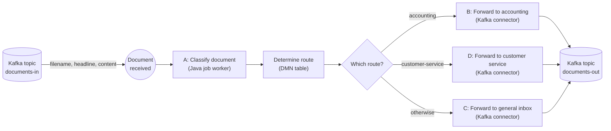

# Camunda 8 Demo

[](https://github.com/qa-stephan-munsch/camunda-demo/actions/workflows/build.yml)

A small, hands-on introduction to [Camunda 8](https://docs.camunda.io/) for developers. One process,
one decision table, Kafka in and Kafka out: small enough to understand at a glance, complete enough
to run on a laptop and see every step in Operate.

## What this repository is about

Documents arrive on a Kafka topic. Each document starts a process instance, gets classified, and is
forwarded to one of three destinations depending on the result. The result is published to another
Kafka topic.



The result message on `documents-out` is `{filename, headline, category, routedTo, priority}`.

- **Kafka in and out is not Java code.** The start event and the tasks B, C and D use the
  **Camunda Kafka connectors**: topic, server and message are configured in the BPMN model, and the
  connectors runtime that comes with Camunda does the work.
- **Step A is a job worker** in a small Spring Boot service, the only Java code in the flow. It finds
  the `category` (`invoice`, `complaint`, `other`) and whether the document is `urgent`.
- **The routing rules are a DMN decision table** (`routing-decision.dmn`) with two inputs (category,
  urgent) and two outputs (route, priority): e.g. an urgent invoice goes to accounting with high
  priority. The exclusive gateway after it only follows the route: B, D, or C for everything else.

The content of the steps is invented (a keyword check stands in for a real classifier). What matters
is the shape: an event starts the process, code does one step, a decision table decides, connectors
talk to the outside world.

## Quickstart

Prerequisites: macOS with Java 21+, Node.js 22.18+ and Docker (Docker Desktop or Colima).

```bash
npm install -g @camunda8/cli                     # c8ctl, the Camunda 8 CLI (once)
demo/run-demo.sh                                 # Camunda (if needed), Kafka, Kafka UI, build, document-service
demo/send-document.sh demo/samples/invoice.json  # in a second terminal
```

Then watch the instance in Operate (http://localhost:8080/operate) and read the result in Kafka UI
(http://localhost:8090, topic `documents-out`). Details: see the **[demo folder](demo/README.md)**.

## Learning path

1. **[Camunda basics](docs/camunda-basics.md):** the concepts (BPMN, DMN, FEEL, jobs, messages,
   connectors), each with a pointer to where the demo uses it.
2. **[Run the demo](demo/README.md):** send the sample documents, follow them in Operate and Kafka UI.
3. **Open the model and the decision table** in [Camunda Desktop Modeler](https://camunda.com/download/modeler/):
   `document-service/src/main/resources/processes/document-routing/` (`document-routing.bpmn`,
   `routing-decision.dmn`).
4. **[Architecture](docs/architecture.md):** the service, the process and the message formats.
5. **[Development](docs/development.md):** build, test, lint, and change the process yourself.
6. **[Pitfalls](docs/pitfalls.md):** what tripped us up while building this, and why.

## Repository layout

```
camunda-demo/
├── README.md                this file
├── docs/                    camunda-basics, architecture, development, pitfalls
├── demo/                    run-demo.sh, send-document.sh, docker-compose.yml (Kafka, Kafka UI), samples
├── pom.xml, mvnw            Maven parent project and wrapper
├── document-service/        classify-document worker; owns and deploys document-routing and routing-decision
└── .github/workflows/       build and tests on every push
```

## Versions

Camunda 8.10 (connectors 8.10), Spring Boot 4.1, Java 21, Apache Kafka 4.1. The Camunda version in
`pom.xml` should match the cluster (`c8ctl cluster status`).
