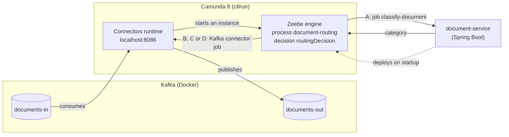

# Architecture

## Components



The engine evaluates the decision table itself ("Determine route"); no job is involved.

| Component | Runs where | Role |
|---|---|---|
| **Zeebe engine** | c8run (`c8ctl cluster start`), `localhost:8080` / `26500` | Executes `document-routing` and evaluates `routingDecision`, keeps the state of every instance |
| **Connectors runtime** | c8run, `localhost:8086` | Runs the Kafka connectors of the model: consumes `documents-in` and starts instances; completes the jobs of B, C and D by publishing to `documents-out` |
| **`document-service`** | Spring Boot, started by `demo/run-demo.sh` | Deploys `document-routing` and `routing-decision.dmn` on startup; job worker `classify-document` |
| **Kafka** | Docker (`demo/docker-compose.yml`), `localhost:9092` | Topics `documents-in`, `documents-out` |
| **Kafka UI** | Docker, http://localhost:8090 | Produce and read messages in the browser |

**Who does what:** the model says *what* happens and in which order. The connectors runtime does the
Kafka work; it reads its configuration (server, topic, message) from the model. The engine evaluates
the decision table itself. Only step A is our own code. Nobody calls anybody directly: the engine hands out jobs, and workers and connectors pick them up.

**Process ownership:** `document-service` deploys everything under
`src/main/resources/processes/` on startup (`@Deployment(resources = "classpath*:/processes/**/*")`).
The model, its decision table, its worker and its tests live in one module.

## Process: document-routing

| Step | Element id | Type | What happens |
|---|---|---|---|
| Document received | `StartEvent_DocumentReceived` | Message start event, **Kafka inbound connector** | Consumes `documents-in` (consumer group `document-routing`, from the earliest offset). One instance per Kafka message; the result expression copies `filename`, `headline`, `content` into process variables |
| A: Classify document | `ClassifyDocument` | Service task, job type `classify-document` | Worker in `document-service` sets `category` (`invoice` / `complaint` / `other`) and `urgent` (`true` / `false`) |
| Determine route | `DetermineRoute` | Business rule task → decision `routingDecision` | Sets `routing` = `{route, priority}` from `category` and `urgent` |
| Which route? | `Gateway_Route` | Exclusive gateway | `=routing.route = "accounting"` → B; `=routing.route = "customer-service"` → D; default flow → C |
| B: Forward to accounting | `ForwardToAccounting` | Service task, **Kafka outbound connector** | Publishes the result to `documents-out` |
| D: Forward to customer service | `ForwardToCustomerService` | Service task, **Kafka outbound connector** | Publishes the result to `documents-out` |
| C: Forward to general inbox | `ForwardToGeneralInbox` | Service task, **Kafka outbound connector** | Publishes the result to `documents-out` |
| Document routed | `EndEvent_DocumentRouted` | End event | |

The Kafka server (`localhost:9092`) and the topic names are written directly in the model, so you see
them in the Modeler's properties panel. A real project would use connector secrets
(`{{secrets.KAFKA_SERVERS}}`) instead.

## Decision: routingDecision

`routing-decision.dmn`, hit policy FIRST (top to bottom, the first matching rule wins):

| category | urgent | → route | → priority |
|---|---|---|---|
| `"invoice"` | `true` | `"accounting"` | `"high"` |
| `"invoice"` | `-` | `"accounting"` | `"normal"` |
| `"complaint"` | `true` | `"customer-service"` | `"high"` |
| `"complaint"` | `-` | `"customer-service"` | `"normal"` |
| `-` (anything, also missing) | `-` | `"general-inbox"` | `"normal"` |

The order matters: the specific rows (`urgent = true`) come before the general ones (`-`), and the
catch-all comes last. `-` also matches a missing value, so a document without `urgent` is treated as
not urgent.

The table has two output columns, so the business rule task stores an object in `routing`
(`resultVariable="routing"`): `routing.route` and `routing.priority`. The gateway follows
`routing.route`; B, C and D put both values into the result message, so route names and priorities
exist in exactly one place. To change where invoices go, change one cell; to add a category, add rules
above the catch-all (and a path in the model if it needs its own destination).

## Messages

### Input: `documents-in`

```json
{ "filename": "invoice-acme.txt", "headline": "Invoice 4711", "content": "Dear customer, please pay …" }
```

All fields are optional for the process: missing fields become `null`, and the document is classified
as `other`. A message that isn't JSON at all also starts an instance with empty fields. The fields
must be text, though: JSON that isn't an object (an array) or has a nested field gets an incident at
"Classify document" ([pitfalls](pitfalls.md#messages-that-arent-json-objects)).

### Output: `documents-out`

Key: `filename`. Value, the same shape from B, C and D:

```json
{ "filename": "invoice-acme-reminder.txt", "headline": "DRINGEND: Rechnung 4711, zweite Mahnung",
  "category": "invoice", "routedTo": "accounting", "priority": "high" }
```

| Field | Meaning |
|---|---|
| `filename`, `headline` | Copied from the input |
| `category` | Result of step A: `invoice`, `complaint` or `other` |
| `routedTo` | From the decision, which path the document took: `accounting` (B), `customer-service` (D) or `general-inbox` (C) |
| `priority` | From the decision: `high` or `normal` |

## Simulated behaviour

`DocumentClassifier` stands in for a real classifier (ML model, LLM, IDP service). It looks at headline
and content together, case-insensitive:

| Result | Keywords |
|---|---|
| `category = "invoice"` | "invoice", "rechnung" (checked first, so "Beschwerde über die Rechnung" is an invoice) |
| `category = "complaint"` | "complaint", "beschwerde", "reklamation" |
| `category = "other"` | none of the above |
| `urgent = true` | "urgent", "dringend" |

"Accounting", "customer service" and "general inbox" are just route names from the decision table;
whoever consumes `documents-out` would act on `routedTo` and `priority`.
